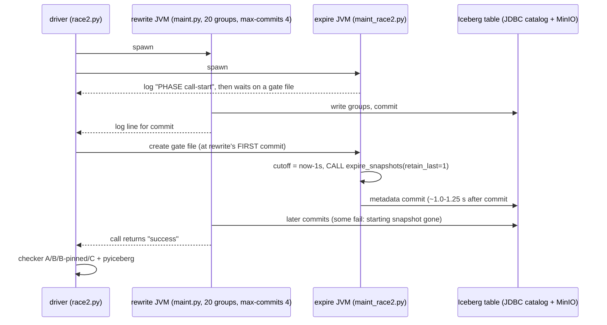

# RACE-RERUN — gated expire-vs-rewrite race, 1.7.1 control, 1.12.0, main@2d89aa4
Run 20 Nov 2026, 11:37–12:0x PT. Local only: nothing posted, pushed, published or filed. Brief: RACE-RERUN-BRIEF.md.

## 1. How the gate works (what talks to what)

Walkthrough: both JVMs start and warm up. The expire JVM stops after printing its start marker and waits for a gate file. The driver polls both logs every 3 ms and creates the gate file when the rewrite's first group commit shows up. The expire then computes its cutoff and commits about a second later, while the rewrite still has groups to commit. All timestamps are the driver's own clock when it saw the log line (inferred from logs, resolution a few ms).

## 2. Summary (read first)
**Overlap was achieved in every attempt, and the #17202 class fires on 1.12.0 and on `main` once the race is real.**

| Build | Attempts | overlap_achieved cells | C flagged among overlap cells | A / B / B-pinned (all attempts) | pyiceberg disagreements |
|---|---|---|---|---|---|
| 1.7.1 (positive control) | 3 | 3 | **3 of 3** (C1b) | 0 / 0 / 0 | 0 |
| 1.12.0 | 8 (quota met at attempt 8 of max 20) | 8 | **8 of 8** (C1b) | 0 / 0 / 0 | 0 |
| main@2d89aa4 | 8 (quota met at attempt 8 of max 20) | 8 | **7 of 8** (C1b); 1 clean | 0 / 0 / 0 | 0 |

C_applicable = 8 of 8 on 1.12.0 and main, 3 of 3 on 1.7.1 (every race cell's rewrite returned, i.e. made a success claim).

**What can now be claimed (and no more):**
1. The earlier "0 of 8 on 1.12.0 and main" was a timing artefact, as the vetting said (VETTING 4.1). With the expire commit forced inside the rewrite's commit window, 1.12.0 shows the same signature as 1.7.1 in 8 of 8 cells and `main` in 7 of 8. There is no evidence of a fix in 1.12.0 or `main`.
2. Signature, same on all three builds: rewrite returns success, 19–20 file groups were ready, only 2–4 commits landed, the commit service logs `Failure during rewrite commit process, partial progress enabled. Ignoring` with `NullPointerException ... Table.snapshot(long) is null` (RewriteDataFilesCommitManager.commitFileGroups line 84 on 1.7.1, line 98 on 1.12.0 and `main`). I read this log line in one cell per build (1.7.1 c02, 1.12.0 c01, main c00); the other cells were classified by the checker's counts and swallowed-exception kinds. 1.7.1 and 1.12.0 also show `ValidationException: Cannot determine history between starting snapshot ...` in some cells. `main` cells logged NPE and `CommitFailedException`, and no ValidationException in the exception-kind counts.
3. It is the known, contested partial-progress behaviour mapped to #17202, not new. As in the vetting, the flag is thin: reported rewritten/added counts equal the checker's truth in all 19 cells (class C2 = 0), and only `failed_data_files_count = 0` is untrue-looking. I did not re-fetch #17202 in this run (still unverified from this run; mapping carried from the earlier reports).
4. No data loss: class A, B and B-pinned are clean in all 19 cells, and pyiceberg agrees with Spark in all 19.

**What cannot be claimed:** nothing about builds in between, other catalogs, or other group counts. Why `main` cell c01 stayed clean (4 of 4 commits, one `CommitFailedException` that was not followed by a failed commit process) is not established; it is 1 cell. "Fires on" means observed in 7–8 of 8 gated cells on this rig, not a rate in the field. The gate is artificial: expire is timed to the rewrite's first commit.

## 3. Design as run
- Rewrite: `maint.py rewrite_small_groups` (unchanged): partial-progress, max-commits 4, max-file-group-size-bytes 40000, min-input-files 2, 1 concurrent group. This already gives 19–20 groups, so I did not shrink the size further.
- Expire: new `chaos/maint_race2.py`: same `expire_snapshots(retain_last=>1, older_than=now-1s)` call as `maint.py expire`, but the cutoff is computed after the gate opens. Frozen files untouched (hash check OK before the run; log logs/race2_hash.log).
- Gate: opened when the rewrite log shows its first `BaseRewriteFiles` commit.
- Events per cell (driver clock): rewrite start, each successful commit, each commit attempt the commit service logged as failed, expire gate release, expire commit (`RemoveSnapshots: Committed snapshot changes`), rewrite return, expire return.
- **overlap_achieved** = expire commit strictly after the rewrite's first successful commit and strictly before its last commit event, where commit events are successful commits plus failed commit attempts logged by the commit service. I added the failed attempts after the 1.7.1 control run (before any 1.12.0 or main cell ran) because on the builds where the race works, the later commits fail and a success-only "last commit" would not exist. The stricter **overlap_success_only** (a rewrite commit succeeded after the expire commit) is recorded too: 1.7.1 1 of 3, 1.12.0 5 of 8, main 8 of 8. Quota counting used overlap_achieved. On 1.12.0, 3 of the 8 cells have no successful commit after the expire, only a failed attempt; if you want the stricter definition, 1.12.0 has 5 and would need 3 more cells to reach 8.
- Expire commit landed 1.02–1.25 s after the rewrite's first commit in every cell (column `rel_expire_commit_minus_first`).
- Unique table per cell (`t_race2_<build>_g3_cNN`). Assertion that the table's store prefix is empty and the catalog has no such table runs before seeding. It fired once on a reused name (see §5), which is the carry-over the vetting warned about.
- Seed 120 batches, ingest running, pinned reader, frozen checker functions (`check_A`, `check_B`, `check_B_pinned`, `check_C_rewrite(race=True)`), pyiceberg 0.12.0 on every cell.

## 4. Evidence
Files: `results/race2/per_interleaving.csv` (one row per cell, with overlap_achieved, overlap_success_only, rewrite start, every commit timestamp, failed-commit timestamps, expire release/commit/return, rewrite return, A/B/Bpin/C/C1/C1b/C2, py A/B, reader_disagree), `results/race2/interleavings.jsonl` (full records), per-cell logs in `work/runs/v<build>-race2/`, driver logs in `logs/race2_v*.log`.

Class C detail (all overlap cells): C1 (success with zero committed) 0; C1b (success while swallowed commit failures left groups unfinished) 3/3 on 1.7.1, 8/8 on 1.12.0, 7/8 on main; C2 (reported != truth) 0. Committed groups per cell: 1.7.1: 2, 2, 3 of 19; 1.12.0: 2–3 of 20; main: 3 (seven cells) or 4 (the clean cell) of 20. Rewritten file counts reported = truth (e.g. 1.12.0 c00 271 rewritten / 10 added of ~480 input files).

B-pinned: 6–7 pinned-read errors per cell on every build, all after the expire removed the untagged pinned snapshot (excused by design, as in the full study); 0 scored.

Scope caveat on the denominator: class C uses the true applicable denominator (all 19 cells made a success claim), but this is a purposely gated arm, so these counts are not comparable to the 123-cell matrix rates.

## 5. Deviations and limits (honest)
1. First gate attempt (SIGSTOP the expire JVM at call-start, resume at the rewrite's first commit) gave overlap 3/3 on 1.7.1 but **did not** reproduce the signature: expire computes its cutoff at call-start, so the rewrite's starting snapshot was still newer than the cutoff and was not expired. Discarded as a control, kept in `results/race2/gate-v1-sigstop-discarded/`. Fixed by `maint_race2.py` (gate before the cutoff).
2. Second run of the 1.7.1 control used a success-only last-commit; superseded after I added failed commit attempts to the overlap definition (see §3), kept in `results/race2/gate-v2-first-run-superseded/`. Both superseded runs are not counted anywhere above.
3. `DROP TABLE ... PURGE` leaves the last `metadata.json` in the store. The empty-prefix assertion caught this on a reused name; tables now carry a unique suffix. Likely related to the cross-run carry-over seen in the earlier orphan counts; I did not test that link.
4. 1.7.1 has only 3 cells (the brief asked for 3). n is small, and the three cells are near-replicates.
5. Timestamps come from log lines at a 3 ms poll, plus log buffering; ordering of events a few ms apart is not trustworthy, but the observed gaps are ~1 s.
6. Same rig limits as FULL-REPORT §9 (MinIO local FS, JDBC catalog, Spark 3.5.3 local[2], observer phases inferred from logs).
7. `main` is commit 2d89aa4 as built on 20 Nov, not newer.

## 6. Disk
Free before: 36,137,924 KB; after: 35,526,780 KB (about 0.6 GB less: MinIO and Postgres data from the retained flagged tables, logs). Spark temp: set `SPARK_LOCAL_DIRS=work/spark-local-race2`; after the run `work/spark-local-race2` was empty and `$TMPDIR` had 0 new `spark-*`/`blockmgr-*` directories versus the baseline of 261 (those 261 are not mine and were left alone). Nothing to delete. Disk guard (>= 6 GB) unchanged and never triggered. Postgres (5433) and MinIO (9100) stopped afterwards.

## 7. Completion note
**Did:** built a gated race driver without touching frozen files; ran 3 control cells on 1.7.1, and 8 gated cells each on 1.12.0 and main (quota met at 8 attempts each); recorded the four timestamps (plus failed-commit events) per cell; ran the frozen checker and pyiceberg on every cell; cleaned and reported disk.
**Found:** with real overlap, the #17202 class fires on 1.12.0 (8/8) and main (7/8) as on 1.7.1 (3/3); A/B clean; readers agree; counts reported are exact (known partial-progress behaviour).
**Blocked / unverified:** #17202 not re-fetched; why one main cell stayed clean; overlap definition was refined once mid-run (disclosed); upstream source not read for the commit path on 1.12.0/main.
